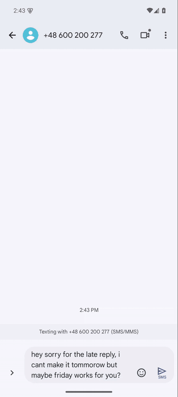

# RewordMe Android – raport z testów E2E (2026-10-11)

Testowany build: **opublikowany `kmp/RewordMe-Android-1.0.0-dev.apk`** (SHA-256 zgodny z plikiem `.sha256`, commit `4477d16`).
Dla porównania wydajności zbudowałem też lokalnie wersję release.

## Na czym testowałem

| Urządzenie | Android | Ekran | RAM | Chrome |
|---|---|---|---|---|
| `worst_api26` – „najgorszy przypadek” (profil Nexus S) | 8.0 (API 26 = minSdk) | 480×800, hdpi (≈320×533 dp) | 1 GB | 69 |
| `modern_api35` – punkt odniesienia (Pixel 6) | 15 (API 35) | 1080×2400 | 2 GB | 124 |

* **Prawdziwy dostawca:** Ollama na Twoim PC (`gemma4:12b-it-qat`), z emulatora pod `10.0.2.2:11434`.
* **Serwer-atrapa** (zgodny z OpenAI) do wymuszania stanów: wolna odpowiedź, 401, 429, quota, 500, 400, HTML 502, pusta odpowiedź, `<think>`, markdown, brak modeli, długi wynik.
* **Aplikacje-hosty:** samouczek w aplikacji (natywny `EditText`), Kontakty (natywne pola), Chrome (`<textarea>`, `<input>`, `contenteditable`, tekst tylko do odczytu).
* **Warianty:** język systemu polski, czcionka 1.3×, przejście do innej aplikacji w trakcie, Back, tap poza okienkiem, klawiatura.
* **Nie podawałem prawdziwych kluczy API**, więc Gemini/OpenAI/Claude nie zostały przetestowane end to end. Ścieżka HTTP była testowana przez klienta OpenAI-compatible (Ollama i atrapa).

Legenda: 🔴 łamie podstawowy scenariusz · 🟠 poważne UX / urwana ścieżka · 🟡 średnie · ⚪ drobne

---

## 🔴 Krytyczne – główny scenariusz nie działa end to end

### C1. „Zastąp” nie działa w Chrome (ani na Androidzie 8, ani na 15)
* **Android 15 + Chrome 124:** dla edytowalnego, aktywnego `<textarea>` i `<input>` popup pokazuje **tylko „Kopiuj”**. Dodałem tymczasowo log i sprawdziłem: Chrome sam wysyła `EXTRA_PROCESS_TEXT_READONLY=true`, mimo że w menu ma „Wytnij”. Zrobiłem też build-sondę z wymuszonym „Zastąp”: Chrome **ignoruje** zwrócony tekst i pole się nie zmienia.
* **Android 8 + Chrome 69:** „Zastąp” jest widoczne, popup się zamyka, a tekst w polu **zostaje bez zmian**, zaznaczenie znika. Sprawdzone 3× (textarea i input; czas odpowiedzi 3–17 s).
* Natywne pola (`EditText`) działają poprawnie. Problem dotyczy WWW (Gmail w przeglądarce, formularze, LinkedIn itd.), czyli dużej części realnego pisania.
* Dla użytkownika: wybiera „Zastąp” i nic się nie dzieje. To wygląda jak „aplikacja nie działa”.
* **Propozycja:** gdy `readonly=true` albo wołającym jest przeglądarka, główną akcją ma być **„Kopiuj”** z wyraźnym komunikatem („Skopiowano – przytrzymaj pole i wklej”). Trzeba też poprawić obietnicę „replaces in place” w samouczku i README. Rozwiązania przez AccessibilityService są ciężkie i problematyczne pod kątem zasad Google Play.
* Zrzuty: `img/05-chrome-brak-zastap.png`, `img/06-chrome124-tylko-kopiuj.png`

### C2. Główny przycisk „Zastąp/Replace” rozjeżdża się na małym ekranie
* EN, 4": łamie się na „Repl / ace” i wygląda jak kółko.
* **PL: „Zastąp” to pusty fioletowy pasek bez żadnego tekstu.** Użytkownik nie wie, co to za przycisk.
* Przyczyna: [`PopupScreen.kt:359-374`](../kmp/android/app/src/main/kotlin/dev/mjablonski/rewordme/android/features/popup/ui/PopupScreen.kt). Rząd mieści „Jeszcze raz” + Spacer + „Kopiuj” + „Zastąp” na ok. 240–310 dp bez zawijania.
* **Propozycja:** „Zastąp” jako przycisk na całą szerokość w osobnym wierszu, „Jeszcze raz” i „Kopiuj” jako drugorzędne pod nim (albo same ikony).
* Zrzut: `img/04-przycisk-zastap-rozjechany.png`

### C3. Okienko popupu się nie przewija, więc przy większej czcionce akcje są nieosiągalne
* Czcionka 1.3× (częsta u starszych osób i na tanich telefonach): w wyniku „Jeszcze raz” i „Kopiuj” są ucięte u dołu, a **„Zastąp” w ogóle nie ma na ekranie**.
* Przyczyna: `Column` karty w [`PopupScreen.kt:120-143`](../kmp/android/app/src/main/kotlin/dev/mjablonski/rewordme/android/features/popup/ui/PopupScreen.kt) nie ma `verticalScroll` ani ograniczenia wysokości.
* Zrzut: `img/04-…` (trzeci kadr)

### C4. Ślepy zaułek przy braku konfiguracji lub złym kluczu
* Popup otwiera się normalnie, choć nic nie jest skonfigurowane. Dopiero po wybraniu akcji pojawia się „Coś poszło nie tak – Nie skonfigurowano klucza API. Dodaj go w Ustawieniach.”
* **Nie ma przycisku „Ustawienia”** i nie ma „Spróbuj ponownie” (błąd jest oznaczony jako nieretryowalny). ✕ jest niewidoczne (patrz S1). Zostaje tylko tap w tło i ręczne szukanie aplikacji w launcherze.
* To samo dotyczy `InvalidApiKey`, `UsageLimitReached`, `NoModelAvailable` (zob. `isRetryable` w [`Provider.kt:271-280`](../kmp/core/models/src/commonMain/kotlin/dev/mjablonski/rewordme/models/Provider.kt)).
* **Propozycja:** sprawdzać konfigurację w `Begin` i od razu pokazać stan „Skonfiguruj RewordMe” z przyciskiem otwierającym `SettingsActivity` (NEW_TASK). Do błędów konfiguracyjnych dodać akcję „Otwórz ustawienia”.
* Zrzut: `img/02-popup-bez-X-i-slepy-zaulek.png`

---

## 🟠 Poważne – UX i urwane ścieżki

### S1. Przycisk zamknięcia (✕) w popupie jest niewidoczny i nie działa (mały ekran)
Długa etykieta modelu („Automatic · Gemini (Recommended)”) wypycha ✕ poza kartę, a tap w to miejsce nic nie robi. Przyczyna: [`PopupScreen.kt:167-180`](../kmp/android/app/src/main/kotlin/dev/mjablonski/rewordme/android/features/popup/ui/PopupScreen.kt) – etykieta ma `widthIn(max=170.dp)` bez `weight`. Poprawka: `Modifier.weight(1f, fill = false)` na etykiecie.

### S2. „Reword me / Przeredaguj” trudno znaleźć w menu zaznaczenia
* **Android 8:** przy **pierwszym** długim przytrzymaniu w danym polu pozycji **w ogóle nie ma** (to błąd platformy – lista aktywności PROCESS_TEXT ładuje się leniwie). Pojawia się dopiero przy drugim zaznaczeniu, i to w menu ⋮.
* **Android 15:** w natywnych polach pozycja też jest w ⋮ (Wytnij/Kopiuj/Udostępnij/Zaznacz wszystko zajmują pasek). W Chrome jest widoczna od razu.
* Samouczek mówi tylko „stuknij »Przeredaguj« w menu” i nie wspomina o ⋮ ani o ponownym zaznaczeniu. Typowy użytkownik uzna, że nie działa.
* **Propozycja:** samouczek krok po kroku z obrazkiem: „⋮ → Przeredaguj”, plus wskazówka „Nie widzisz? Zaznacz jeszcze raz”.
* Zrzut: `img/01-menu-zaznaczenia-android8.png`

### S3. Ekran główny na Androidzie < 11: po zamknięciu klawiatury znika połowa ekranu
Po jednym otwarciu klawiatury (np. długie przytrzymanie w „Wypróbuj”) `imePadding` zostaje na stałe. Dolne ~45% ekranu jest puste, a pole samouczka wypada poza widok. Po „Zaznacz wszystko” widoczny obszar spada do ~100 px i zaznaczony tekst jest niewidoczny (widać tylko uchwyty). Treść przewija się też pod pasek statusu.
Przyczyna: `HomeActivity` i `SettingsActivity` nie mają `android:windowSoftInputMode="adjustResize"` w [`AndroidManifest.xml`](../kmp/android/app/src/main/AndroidManifest.xml), a Compose `WindowInsets.ime` poniżej API 30 tego wymaga ([`HomeScreen.kt:54-60`](../kmp/android/app/src/main/kotlin/dev/mjablonski/rewordme/android/features/home/ui/HomeScreen.kt)). Ten sam wzorzec jest w `SettingsScreen.kt` (ryzyko).
Zrzut: `img/03-home-fantomowa-przestrzen.png`

### S4. Łatwo stracić wynik
* **Systemowe Back** w widoku wyniku zamyka cały popup i wynik przepada, a strzałka ‹ w popupie wraca do menu. Zachowanie jest niespójne.
* **Tap poza kartą** w trakcie ładowania lub przy wyniku zamyka popup bez pytania. Na 4" tło to duża powierzchnia. Jeśli wynik kosztował pieniądze albo trwał ~70 s, to boli.
* **Propozycja:** `BackHandler`, który cofa o jeden etap. Zamykanie przez tło tylko w etapach MENU/EMPTY.

### S5. Popup nie pokazuje, CO zostanie przeredagowane
Długie przytrzymanie zaznacza **jedno słowo**. W testach rewrite dostał tylko „yesterday” i zwrócił „the previous day”, „budjet” → „budget”. Użytkownik nie widzi, że zaznaczył tylko słowo. **Propozycja:** w nagłówku podgląd zaznaczenia (1–2 linie + liczba znaków). Przy Korekcie warto też pokazać różnice w wyniku.

### S6. Surowe, techniczne komunikaty błędów
* `Connect timeout has expired [url=http://192.168.250.250:11434/v1/models, connect_timeout=15000 ms]`
* `Failed to connect to localhost/127.0.0.1:11434`
* `Provider error (502): <html><body><h1>502 Bad Gateway</h1>nginx</body></html>`
* Przyczyna: `UiError.Raw(failure.message)` w [`UiError.kt`](../kmp/android/app/src/main/kotlin/dev/mjablonski/rewordme/android/common/UiError.kt). Brak mapowania IOException/UnknownHost/Timeout i brak wykrywania trybu offline.
* Zrzut: `img/07-surowe-bledy.png`

### S7. Ollama: domyślny adres nie może działać na telefonie
Domyślnie jest `http://localhost:11434`, a na telefonie to sam telefon. Opis mówi o „tym komputerze”. Nie ma podpowiedzi, że na PC trzeba ustawić `OLLAMA_HOST=0.0.0.0` i wpisać IP komputera w LAN. Nie ma też przycisku „Testuj połączenie”. ([`Provider.kt:289`](../kmp/core/models/src/commonMain/kotlin/dev/mjablonski/rewordme/models/Provider.kt))

### S8. Rozpowszechniany APK to build **debug** – to jeden z powodów, dla których „słabo działa”
* `RewordMe-Android-1.0.0-dev.apk`: flaga `DEBUGGABLE`, bez R8, **19,7 MB**. Release z tego samego kodu: **1,9 MB**. Smoke test release przeszedł (popup, błędy, tłumaczenia, ekran główny, ustawienia).
* Zimny start popupu na Androidzie 8 (emulator na szybkim i7): **debug 630–740 ms**, **release ~510 ms**.
* Ten sam scenariusz (menu → akcja): klatki z przycięciem **60% (p90 400 ms) w debug** vs **29% (p90 21 ms) w release**. Emulator renderuje programowo, więc liczby bezwzględne są zawyżone, ale proporcja jest wymowna. Na słabym telefonie ARM różnica będzie jeszcze większa.
* **Propozycja:** publikować podpisany APK release i dodać baseline profile.

### S9. Długie czekanie bez informacji
Pierwsze wywołanie trwało **72 s** (zimny start modelu w Ollamie), timeout połączenia 15–17 s. Przez cały ten czas widać tylko „Przeredagowywanie…” i spinner. Przydałby się licznik czasu, komunikat po ~10 s („To trwa dłużej niż zwykle…”) i łatwo dostępne „Anuluj”.

---

## 🟡 Średnie

| # | Problem | Gdzie |
|---|---|---|
| M1 | Po „Kopiuj” **brak potwierdzenia** na Androidzie < 13 (systemowy toast dochodzi dopiero od 13). Popup po prostu znika. | `PopupViewModel.copy()` |
| M2 | Pisanie własnej instrukcji: klawiatura zasłania presety i przyciski, zostaje tylko klawisz „Wyślij” na IME. Przy długim wyniku pole jest do połowy pod paskiem sugestii, a nagłówek wypada za górną krawędź. | `img/08-…` |
| M3 | Krótkie zaznaczenie („ok”, „12”) pokazuje „Nie ma jeszcze nic do przeredagowania. Zaznacz tekst…”, choć użytkownik zaznaczył. Lepiej: „Zaznaczenie jest za krótkie”. | `ProcessTextActivity.kt:35` |
| M4 | Etykieta modelu w nagłówku jest techniczna i nieprzetłumaczona („Automatic · Ollama (External local)”, „gemma4:12b-it-qat · Ollama (E…”) w polskim UI. Zabiera miejsce (S1). | `PopupViewModel.modelLabel()` |
| M5 | Wynik modelu nie jest czyszczony: `<think>…</think>`, markdown (`**…**`) i wstęp „Here is the rewritten text:” trafiają 1:1 do wyniku i do „Zastąp”. | `OpenAiCompatibleClient.parseReword` |
| M6 | Nagłówek „Coś poszło nie tak” także dla błędów konfiguracji. 401 przy Ollamie mówi o „kluczu API”, którego Ollama nie ma. | `PopupScreen.ErrorView`, `Localized.kt` |
| M7 | 429 „Spróbuj za 20 s”, a przycisk „Spróbuj ponownie” jest aktywny od razu (bez odliczania). | `ErrorView` |
| M8 | Po „Zastąp” nie ma cofnięcia (wiele aplikacji-hostów nie ma undo). | – |
| M9 | „Przeredaguj” to jednocześnie nazwa pozycji w menu zaznaczenia i przycisk „Rewrite” w popupie. Po polsku myli. | `values-pl/strings.xml` |
| M10 | Na Androidzie 8 pole „Opisz, co chcesz zmienić” dostaje fokus od razu po otwarciu popupu. Do sprawdzenia, czy to nie przyczynia się do utraty zaznaczenia w hoście (C1, Chrome 69). | `PopupScreen.DescribeField` |

## ⚪ Drobne (głównie setup)

* Ustawienia nie mają strzałki „wstecz” w pasku; wyjście jest tylko przez systemowe Back.
* Po zapisaniu klucza nie ma „Testuj połączenie”. O złym kluczu użytkownik dowiaduje się dopiero w innej aplikacji.
* Pole klucza nie ma przełącznika „pokaż” ani przycisku „Wklej”.
* Lista dostawców nie oznacza aktualnego wyboru, menu przesłania tytuł.
* Lista modeli pokazuje surowe ID. Błąd „Wczytaj modele” pojawia się poniżej widocznego obszaru.
* Na ekranie głównym przy starcie mruga podpowiedź konfiguracji, bo `HomeState.isConfigured` ma domyślnie `true`.
* Na 4" sekcja „Wypróbuj” jest poza ekranem przy starcie, a długie przytrzymanie otwiera klawiaturę na pół ekranu.

---

## ✅ Co działa dobrze

* **Natywne pola** (samouczek, Kontakty): zaznacz → Przeredaguj → akcja → **Zastąp podmienia tekst w miejscu**, na Androidzie 8 i 15.
* Tekst **tylko do odczytu**: pokazuje się tylko „Kopiuj” i kopiowanie działa (sprawdzone wklejeniem).
* Wyjście z aplikacji w trakcie generowania i powrót przez „Ostatnie”: żądanie trwa dalej i wynik się pokazuje.
* Anulowanie i nowe żądanie unieważniają stare (w logu serwera nie ma duplikatów). Obrót nie dubluje żądań.
* Mapowanie błędów: rate limit, quota, 5xx (z ponowieniem), pusta odpowiedź, brak modeli.
* Polskie tłumaczenie popupu jest kompletne.
* Build z czystego klona i testy jednostkowe przechodzą (`assembleDebug`, `testDebugUnitTest`, `assembleRelease`).

## Proponowana kolejność napraw

1. **C2 + C3 + S1:** układ popupu (Zastąp w osobnym wierszu, przewijanie, etykieta z `weight`). Mało pracy, duży efekt.
2. **C4:** stan „nieskonfigurowane” od razu po otwarciu i przycisk „Otwórz ustawienia” przy błędach.
3. **C1:** strategia dla Chrome i przeglądarek: główną akcją „Kopiuj” z jasnym komunikatem; uczciwy opis w samouczku i README.
4. **S8:** publikować APK release (R8 + podpis + baseline profile).
5. **S3:** `adjustResize` dla Home/Settings.
6. **S4, S5, S6, S9:** ochrona wyniku, podgląd zaznaczenia, przyjazne błędy, informacja o czasie.
7. **S2:** samouczek z „⋮ → Przeredaguj”.

## Czego nie sprawdziłem

* Fizyczny telefon ARM (emulator x86 na szybkim CPU zaniża problemy z wydajnością).
* Gmail, WhatsApp, Messenger, Google Docs (nie ma ich w obrazach emulatora), a to główne miejsca pisania. Warto sprawdzić C1 na nich na Twoim telefonie.
* Nakładki producentów (Samsung One UI, MIUI), które mają własne menu zaznaczenia.
* Dostawcy z kluczem (Gemini/OpenAI/Claude/Mistral/xAI/DeepSeek), bo nie wprowadzałem kluczy.
* Orientacja pozioma: launcher pod spodem był zablokowany w pionie.

## Jak odtworzyć środowisko

* Android SDK: `%LOCALAPPDATA%\Android\Sdk` (cmdline-tools, platform-tools, emulator, platforma 35, build-tools 34, obrazy systemu API 26 i 35 x86_64).
* `kmp/local.properties` → `sdk.dir=C:/Users/user/AppData/Local/Android/Sdk` (plik jest w `.gitignore`).
* AVD: `worst_api26` (Nexus S, 1 GB RAM) i `modern_api35` (Pixel 6).
* Build i testy (z katalogu `kmp`, `JAVA_HOME` = JDK 21):
  `./gradlew :android:app:assembleDebug :android:app:testDebugUnitTest`
* Emulator: `%LOCALAPPDATA%\Android\Sdk\emulator\emulator.exe -avd worst_api26`
* Ollama z emulatora: w ustawieniach RewordMe → Ollama → serwer `10.0.2.2:11434`.

---

# Po poprawkach – retest (2026-10-11, wieczór)

Build z poprawkami (`assembleDebug` z working tree), te same emulatory (Android 8 po polsku, Android 15), atrapa serwera i **prawdziwy Gemini** (klucz wpisał w aplikacji właściciel).
Testy jednostkowe: **77/77 zielone** (core 50, Android 27; 8 nowych testów).

| # | Problem | Status | Jak sprawdzone |
|---|---|---|---|
| **NOWY** | Gemini „Automatycznie” wybierał model TTS `gemini-3.8-flash-lite-tts` → **każde przeredagowanie kończyło się błędem 400** („Developer instruction is not enabled”). Domyślny, polecany dostawca nie działał z prawdziwym kluczem. | ✅ naprawione (wspólny core: filtr modeli Gemini + `ModelResolver` stosuje ten sam filtr) | Prawdziwy Gemini: Automatycznie → `gemini-3.5-flash-lite`, EN ~5 s, PL ~2 s z polskimi znakami, samouczek → Professional → Zastąp podmienia tekst |
| C1 | Chrome nie podmienia tekstu | ⚠️ obejście (Chrome nie da się naprawić): gdy host blokuje podmianę → wyjaśnienie + „Kopiuj” jako główny przycisk; gdy host to przeglądarka → „Zastąp” dodatkowo kopiuje do schowka i pokazuje komunikat | Android 15/Chrome 124: tylko „Kopiuj” + wyjaśnienie, wklejenie działa. Android 8/Chrome 69: toast „Skopiowano też do schowka…”, wklejenie wstawia poprawiony tekst |
| C2 | „Zastąp” rozjechane / puste po polsku | ✅ pełna szerokość, osobny wiersz, etykiety zawsze w 1 linii | Android 8 (PL, 480×800) |
| C3 | Popup bez przewijania | ✅ karta się przewija | Czcionka 1.3×: wszystkie akcje osiągalne |
| C4 | Ślepy zaułek bez klucza | ✅ stan „Najpierw wybierz dostawcę…” od razu przy otwarciu + przycisk „Ustawienia”; przy błędach klucza/modelu/sieci też „Ustawienia” | Ustawienia otwierają się w osobnym zadaniu, ← wraca |
| S1 | Niewidoczne ✕ | ✅ | Widoczne na 4" |
| S2 | „Przeredaguj” trudno znaleźć | ⚠️ podpowiedź w samouczku („Otwórz menu ⋮ … Android 8–9 dopiero po ponownym zaznaczeniu”) – błędu platformy nie da się obejść | Android 8 |
| S3 | Pusta połowa ekranu głównego | ✅ `adjustResize|stateHidden`; pole samouczka nie otwiera klawiatury | Android 8: po zamknięciu klawiatury pełny widok |
| S4 | Utrata wyniku | ✅ Back cofa etap (wynik → menu → zamknięcie), tap w tło ignorowany przy ładowaniu i wyniku | Android 8 |
| S5 | Brak podglądu zaznaczenia | ✅ podgląd (2 linie, kursywa) w menu | |
| S6 | Surowe błędy | ✅ błędy sieci/timeout przetłumaczone, HTML z odpowiedzi usuwany („Błąd dostawcy (502): 502 Bad Gateway nginx”) | |
| S7 | Ollama `localhost` | ✅ podpowiedź pod polem (pomarańczowa, gdy adres wskazuje telefon) | |
| S8 | APK debug | ❌ nie zmieniałem opublikowanego APK – decyzja wydaniowa (podpis release) | – |
| S9 | Długie czekanie bez informacji | ✅ po 8 s „Wciąż pracuję…” | |
| M1 | Brak potwierdzenia kopiowania | ✅ toast „Skopiowano do schowka” na Androidzie < 13 | |
| M2 | Klawiatura zasłania popup | ✅ karta mieści się nad klawiaturą i przewija | |
| M3 | Krótkie zaznaczenie | ✅ „Zaznaczenie jest za krótkie…” | |
| M4 | Techniczna etykieta modelu | ✅ „Automatycznie · Gemini”, „gemini-3.5-flash-lite · Gemini” | |
| M5 | `<think>` w wyniku | ✅ usuwane (markdown/wstępy nadal nie) | |
| M6–M10, drobne | – | częściowo: strzałka ← w Ustawieniach, ✓ przy wybranym dostawcy, brak mrugania podpowiedzi na ekranie głównym, Ustawienia nie otwierają klawiatury przy starcie (Android 8) | |

**Znaleziono i naprawiono przy okazji retestu:** `adjustResize` powodował na Androidzie 8 automatyczne wysuwanie klawiatury (Home, Ustawienia) – dodane `stateHidden` i „pochłaniacz” początkowego fokusu w Ustawieniach.

**Zostało otwarte:**
* S8 – publikacja APK release (R8, podpis, baseline profile).
* Chrome i tak nie podmienia tekstu – zostaje kopiuj-wklej (teraz jasno komunikowane).
* Błąd platformy Androida 8–9 (brak pozycji przy pierwszym zaznaczeniu) – tylko podpowiedź.
* `:android:platform:testDebugUnitTest` zawiesza się na Windows (niezwiązane z poprawkami, do sprawdzenia).
* Zmiana w `core` (filtr modeli Gemini) dotyczy też aplikacji desktopowych – testy core przechodzą, ale desktopu nie testowałem ręcznie.

Zrzuty po poprawkach: `img/10-…`, `img/11-…`, `img/12-…`.

---

# Test w innych aplikacjach (Android 15, prawdziwy Gemini)

**Najważniejsze:** od Androida 11 aplikacja-host pokazuje w menu zaznaczenia tylko te akcje PROCESS_TEXT, które „widzi” (deklaruje `<queries>` albo ma `QUERY_ALL_PACKAGES`). RewordMe nie może tego zmienić po swojej stronie.

| Aplikacja | Widzi RewordMe? (`dumpsys package queries`) | „Reword me” w menu | Wynik |
|---|---|---|---|
| Wiadomości Google (SMS) | ❌ | ❌ brak (jest tylko „Read aloud”) | ✅ przez **Udostępnij → Reword me** (nowe): Gemini poprawił SMS, Kopiuj → wklejenie w pole wiadomości |
| Kontakty Google | ❌ | ❌ brak | – (Udostępnij dostępne w pasku) |
| Gmail | ❌ | – nie da się sprawdzić bez konta (ja nie loguję się na konta) | wg analizy jak SMS: tylko przez Udostępnij |
| Kalendarz, Zegar, Mapy, YouTube, Dysk, Zdjęcia | ❌ | – | wg analizy: tylko przez Udostępnij |
| Chrome | ✅ (`QUERY_ALL_PACKAGES`) | ✅ | Kopiuj (Chrome nie przyjmuje podmiany) |
| Ustawienia (wyszukiwarka), Pliki, Telefon | ✅ | ✅ (sprawdzone w Ustawieniach) | – |
| Samouczek RewordMe | ✅ | ✅ | Zastąp działa |

**Poprawka:** RewordMe jest teraz także celem udostępniania (`ACTION_SEND text/plain`) – w każdej aplikacji z „Udostępnij” w menu zaznaczenia można przeredagować tekst; wynik wraca przez Kopiuj (popup wyjaśnia dlaczego). Samouczek mówi o tej drodze.

**Na Androidzie 8–10** filtra widoczności nie ma – tam „Przeredaguj” pojawia się w aplikacjach z klasycznymi polami tekstowymi (z opisanym wcześniej błędem pierwszego zaznaczenia).

**WhatsApp, Messenger, Instagram, Telegram, Slack, Teams, Outlook itd.** – nie da się ich zainstalować na tym emulatorze (brak Sklepu Play, a pobieranie APK z nieoficjalnych źródeł odpada). Zależnie od tego, czy deklarują widoczność PROCESS_TEXT, zadziała „Reword me” albo tylko Udostępnij. Najszybciej sprawdzić to na telefonie: po podłączeniu przez USB (debugowanie) `dumpsys package queries` pokaże dla wszystkich zainstalowanych aplikacji naraz, które widzą RewordMe.

Zrzuty: `img/13-sms-brak-pozycji-i-share.png`, `img/14-kontakty-vs-ustawienia.png`.

---

# Every supported Android version (API 26–36)

An automated end-to-end suite (`kmp/android/app/src/androidTest/.../RewordMeE2ETest.kt`, UiAutomator) drives the real system UI on clean emulators against the mock provider. It covers ten scenarios:

1. Tutorial: selection menu → "Reword me" → Proofread → Replace, text swapped in place, no keyboard.
2. Missing key: setup state → Settings, and no keyboard opens by itself.
3. A result survives a backdrop tap; Back goes result → menu → close.
4. Errors: 401 offers Settings, a 502 HTML page is stripped, an unreachable host shows the network message with Try again.
5. Read-only host: Copy first, with the explanation.
6. The share-sheet entry is registered and works without a result channel.
7. A too-short selection explains itself.
8. Close fades out and the activity finishes.
9. The keyboard in Settings leaves no stale space behind.
10. Font 1.3×: every result action is reachable and Replace is full width.

| Android | API | Device | Result | Can Messages / Gmail / Contacts see RewordMe? | Chrome |
|---|---|---|---|---|---|
| 8.0 | 26 | 480×800 (Nexus S) | ✅ 10/10* | yes | yes |
| 8.1 | 27 | Pixel 4 | ✅ 10/10* | yes | yes |
| 9 | 28 | Pixel 4 | ✅ 10/10 | yes | yes |
| 10 | 29 | Pixel 4 | ✅ 10/10 | yes | yes |
| 11 | 30 | Pixel 4 | ✅ 10/10 | **no** | yes |
| 12 | 31 | Pixel 4 | ✅ 10/10 | **no** | yes |
| 12L | 32 | Pixel 4 | ✅ 10/10 | **no** | yes |
| 13 | 33 | Pixel 4 | ✅ 10/10 | **no** | yes |
| 14 | 34 | Pixel 4 | ✅ 10/10 | **no** | yes |
| 15 | 35 | Pixel 6 | ✅ 10/10 | **no** | yes |
| 16 | 36 | Pixel 4 | ✅ 10/10 | **no** | yes |

\* On Android 8.x UiAutomator cannot reach the floating selection toolbar, so test 1 is skipped there. Its manual result is earlier in this report: "Reword me" shows from the second selection, under ⋮, and Replace works.

**Found and fixed during the matrix:** on Android 8–9 the popup opened the keyboard over its own result after a stage change. The cross-fade removed the focused node and the old focus rules handed focus to the describe field. The popup header is now the focus target.

**Test infrastructure, not the app:**
- The mock server needed a larger connection backlog and HTTP/1.1 to serve four emulators at once.
- The suite taps "Try again" once on a dropped emulator connection, as a user would.

**Visibility:** from Android 11 onward, the stock Messages, Gmail and Contacts apps cannot list RewordMe in their selection menu; on Android 8–10 everything can. The Share route added earlier is therefore the way in on Android 11+.

---

# 1.1.0: the floating icon, Android 12–16 (API 31–36)

**Why the icon.** From Android 11 Messages, Gmail and Contacts cannot list "Reword me" in their selection menu. One workaround was tried and dropped: RewordMe launching Messages *for a result* makes Messages see RewordMe ("queryable via interaction"), and "Reword me" then appears under ⋮ with Replace working. But Android forgets that grant on every reboot and every app update, and a plain launch does not grant it. The floating icon does not depend on the host at all: an accessibility service notices a selection in any app, shows a small RewordMe icon next to it, and writes the rewrite back into the field.

**Minimum version raised to Android 12 (API 31).** The Android 8–11 workarounds are gone: the pre-API 28 focus sinks, the Android 8–9 "second selection" hint, and the pre-API 30 window-metrics fallback.

The suite now has 15 scenarios: the ten above, plus five for the icon:

11. Tutorial: a selection gets the icon, clear of the selection toolbar; tap → Proofread → Replace lands in the field; the icon goes when the selection does.
12. **Google Messages**: the first long-press into a draft that is not focused yet gets the icon; Replace lands in the Messages field.
13. Deselecting hides the icon.
14. RewordMe's own switch hides the icon without Android settings.
15. Closing the popup without a rewrite brings the icon back for another go.

| Android | API | Device | Result |
|---|---|---|---|
| 12 | 31 | Pixel 4 | ✅ 15/15 |
| 12L | 32 | Pixel 4 | ✅ 15/15 |
| 13 | 33 | Pixel 4 | ✅ 15/15 |
| 14 | 34 | Pixel 4 | ✅ 15/15 |
| 15 | 35 | Pixel 6 | ✅ 15/15 |
| 16 | 36 | Pixel 4 | ✅ 15/15 |

The Google Messages scenario runs on every version: the stock Messages of each image (older builds label the button next to the draft differently, and once a thread opened without its draft, which the test then fills in itself, unfocused).

**Found and fixed while testing the icon:**
- A fresh install opened Settings with an orange "Android's switch is still off" warning before anyone had asked for the icon. RewordMe's switch now starts off, and turning the service on in Android's settings counts as asking.
- With the keyboard right below the selected line, the icon landed on the selection toolbar and covered its Share button. It now goes just above the selection, and above the toolbar when that is there; below only when there is no room at the top; never on the toolbar or the keyboard.
- The icon appeared before the toolbar (Android shows it only once the finger lifts) and then jumped out of its way. Its first appearance now waits for the toolbar (up to 0.9 s in apps without one), and any later move glides.
- Opened from the icon, the popup appeared without its fade: the new task's system transition ran first and the fade was over before the window showed. The popup now starts the fade once its window is on screen, and the icon launches it without a system animation.
- **The first long-press into an unfocused field in Google Messages showed no icon** (caught in the dry run for the demo: every test before had used a field that was already focused). Messages reports that selection from a view it swaps out right away, and sends nothing for the real field. The icon now also checks the field with input focus.

**Android behaviour worth knowing (not fixable in the app):**
- **Force stop switches the service off.** Android removes a force-stopped app's accessibility service from the enabled list, and opening the app does not bring it back. RewordMe's Settings then shows the warning with a link to Accessibility settings, and the home screen shows "Set up the floating icon" again.
- Android 13+ may grey the switch out for an APK installed from a file ("Restricted setting"); App info → ⋮ → *Allow restricted settings* unlocks it. The Settings hint says so.
- Android's confirmation reads "full control of your device" for every accessibility service; RewordMe's own explanation comes first.

**Test infrastructure, not the app:**
- UiAutomator connects as an accessibility client and by default switches every other accessibility service off; the icon tests ask it not to. With the service under test running in the same process, UiAutomator no longer lists classic text fields (the service still sees them), so those tests find the field through the raw accessibility connection or next to a neighbouring button, wait until its layout settles, and read it back through the focused node or the activity.
- `am instrument` force-stops the app first, which (see above) drops its accessibility service; the tests turn it off and on again.
- An emulator with a visible window attaches the PC keyboard as a hardware keyboard, and Gboard then shows its small toolbar instead of the on-screen keyboard. The Settings keyboard test only means something on a headless emulator, which is how the matrix runs.

**Release APK smoke test (Android 15, `RewordMe-Android-1.1.0.apk`):** configured through its own UI against the PC's Ollama (`10.0.2.2:11434`, `gemma4:26b-a4b-it-qat`). Disclosure → Android's Accessibility page → Allow → the switch shows on → the icon in Google Messages → real rewrites replaced in place. That run produced the demo:

The rewrites in it are real output of the local model; the waiting for it is cut short.
