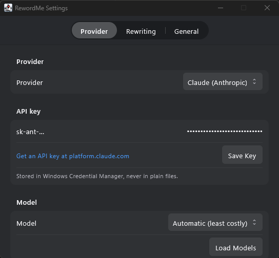
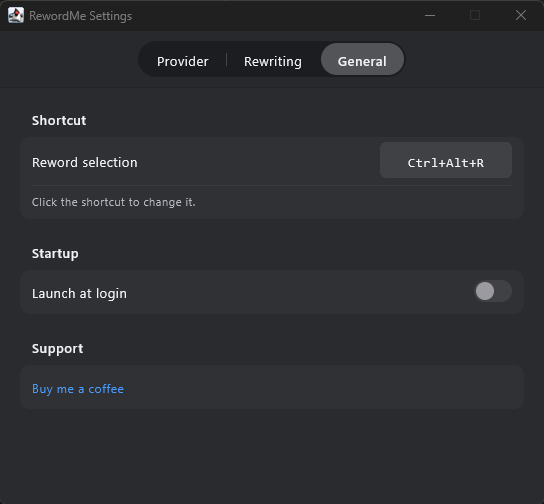

# RewordMe - Kotlin Multiplatform (Windows, Linux, Android)

The KMP sibling of the [macOS app](../macos/): Compose Multiplatform desktop app targeting
**Windows first**, plus an **Android** app on the same core; Linux is planned.

## Status: 1.0.1, released for Windows; Android test build available

Linux remains planned on the same core.

Working:
- Tray icon with menu (Reword Selection, Settings, Buy Me a Coffee, Quit)
- Global hotkey via `RegisterHotKey`, default **Ctrl+Alt+R**, recordable in Settings.
  Registration failures and conflicts open Settings instead of failing silently - without a
  working shortcut there is no way into the app
- Selection capture: synthesized Ctrl+C with clipboard save/restore
- Popup window, pre-warmed at launch so the first hotkey press pays no composition cost:
  menu-first UI (describe field, Proofread/Rewrite, tone presets), result view with
  Again/Copy/Replace. The frame follows the content as stages change, and the header strip
  doubles as a title bar so the undecorated window can still be dragged
- Replace in place: focus restore to the host window + paste + clipboard restore
- DWM acrylic backdrop + rounded corners + tool-window style (no taskbar/Alt-Tab entry),
  solid translucent fallback where acrylic is unavailable
- Settings in three tabs (Provider, Rewriting, General): API/account/local setup, endpoint, model
  pick, rules and base prompt, shortcut recorder, launch at login. Styled as the macOS
  grouped `Form` it mirrors - segmented tab picker on a toolbar strip, sections as cards of
  hairline-divided rows, label left and control right - down to the greys, which are sampled
  off the screenshots in `macos/docs/media`. The title bar is dark so the window has no seam
- Launch at login is **on by default**: the app registers itself for startup on first run,
  because a tray app that is not running cannot answer its shortcut. The answer is recorded
  in `config.json`, so switching it off sticks. macOS does the same via `SMAppService`
- API keys in Windows Credential Manager, migrated off the phase-1 plaintext file on first run
- Localized into 10 languages besides English
- App icon drawn in code, shared by the tray glyph, the window icon and the packaged `.ico`
- All providers, unfiltered and ordered consistently with macOS: Gemini (recommended), Offline
  models (local), OpenAI API, Codex via ChatGPT, Claude API, Claude account, Mistral, Grok, DeepSeek,
  and Ollama. Each provider remembers its own model selection
- Managed offline-model catalog with pinned revisions/SHA-256 digests, per-model selection,
  determinate progress, cancel/retry/remove, and bundled verified x64 + ARM64 llama.cpp Windows
  runtimes—no Ollama installation required. The catalog includes Qwen, Google Gemma, Hugging Face
  SmolLM3, and Mistral Ministral options; model source and license links are visible in Settings
- Separate direct-API and subscription-account execution. Codex and Claude detect their official
  local executable, redirect to official setup when missing, and leave authentication token
  ownership entirely with that executable

Still planned: UI Automation `TextPattern` (clipboard-free reads + a selection rectangle to
place the popup against), Linux support.

## Android

### Download the test APK

Download [`RewordMe-Android-1.0.0-dev.apk`](RewordMe-Android-1.0.0-dev.apk) directly on an
Android 8.0 or newer phone—no USB cable is needed. Open the downloaded file and allow your
browser or file manager to install unknown apps when Android asks. The accompanying
[`SHA-256 file`](RewordMe-Android-1.0.0-dev.apk.sha256) can be used to verify the download.

This is a debug-signed development build (`dev.mjablonski.rewordme.debug`), intended for
hands-on testing rather than Play Store distribution. It can remain installed alongside a
future production-signed RewordMe release.

The phone has no global hotkey, so the entry point is the OS text-selection menu
(`ACTION_PROCESS_TEXT`): select text in any app, tap **Reword me** (localized per language,
e.g. *Przeredaguj*, *Reformuler*, *リライト*), and the popup opens with the same menu-first
flow as the desktops - describe field, Proofread/Rewrite, tone presets, then
Again/Copy/Replace. **Replace** hands the rewrite back through `EXTRA_PROCESS_TEXT`, so the
host app's own field swaps the selection in place; read-only selections offer Copy instead.

- Architecture mirrors the tvapp conventions: per-feature `di` / `presentation` / `ui`
  packages, MVI (`MviViewModel` with a single `StateFlow` state, intents in, one-shot
  effects out), domain `UseCase`s, DI with Koin
- Same business values as desktop: providers (minus the desktop-only account CLIs and the
  managed llama.cpp runtime - Ollama stays, it is just a server address), automatic model
  resolution, rules, base prompt, one-shot steering, the same dark palette by default
- API keys are AES-256-GCM encrypted with a key that lives in the **Android Keystore** and
  never leaves the device; the ciphertext is excluded from backups
- Launcher home screen doubles as a live tutorial: a prefilled editor whose text you select
  to run the real selection-menu flow end to end, plus a first-run setup hint
- Dev vs release: debug builds install side by side (`.debug` id suffix, `-dev` version
  suffix); release signing reads git-ignored `android/app/keystore.properties`
  (see `keystore.properties.example`), falling back to the debug key so any clone builds

```bash
./gradlew :android:app:assembleDebug      # debug APK
./gradlew :android:app:assembleRelease    # minified, signed if keystore.properties exists
./gradlew :android:app:testDebugUnitTest  # view-model and reducer tests
./gradlew :desktop:app:makeAndroidIcons   # regenerate launcher icons from the drawn mark
```

The Android modules (and the android targets of the core modules) activate only when an
Android SDK is discoverable - `sdk.dir` in `local.properties` or `ANDROID_HOME`. Machines
without one, like the Windows packaging box, keep building the desktop with just a JDK.

## Settings

| Provider | General |
|---|---|
|  |  |

Captured from the real window by `./gradlew :desktop:app:settingsShots`, which refuses to
write a shot unless the pixels prove it is the settings window on the expected tab - a screen
grab otherwise photographs whatever happens to be in front.

## Architecture

Layered clean architecture, Gradle modules, dependencies pointing inward only:

```
core:models        pure value types (KMP, commonMain; jvm + android targets)
core:domain        business rules + ports: PromptBuilder, ModelSelection, ModelResolver,
                   UseCase base + use cases, ConfigStore/ApiKeyStore/ProviderAvailability
core:data          IO. commonMain: the pure Ktor provider clients + RewordService (engine
                   discovered per platform: CIO on desktop, OkHttp on Android). jvmMain:
                   account-CLI and managed llama.cpp gateways, JSON config, plaintext
                   key-store fallback
desktop:platform   Win32 via JNA: hotkey, SendInput, focus tracking, DWM acrylic,
                   Credential Manager, run-at-login
desktop:app        Compose UI (MVVM) + composition root
android:arch       MVI plumbing only (MviViewModel, State/Intent/Effect contracts)
android:platform   Keystore-encrypted key store, filesDir config store, clipboard,
                   provider availability
android:app        Jetpack Compose features (popup, settings, home) + Koin modules
```

## Build and run

```bash
./gradlew build                     # compiles + runs all tests (works on any OS)
./gradlew :desktop:app:run          # run (Windows for real behavior; dev stubs elsewhere)
./gradlew :desktop:app:packageMsi   # Windows installer (run on Windows)
./gradlew :desktop:app:packageExe   # standalone installer
```

For the Windows 1.0.1 release, install a 64-bit JDK 21 and WiX Toolset 3.x, make sure
`JAVA_HOME` and WiX's `bin` directory are on `PATH`, then run this from PowerShell:

```powershell
cd kmp
.\package-windows.ps1
```

The script runs the full build and tests, downloads and verifies the pinned x64/ARM64 local AI
runtimes, creates the EXE installer, verifies the configured version, and copies
`RewordMe-1.0.1.exe` plus its SHA-256 file into the `kmp` directory. Follow
[`WINDOWS_TEST_CHECKLIST.md`](WINDOWS_TEST_CHECKLIST.md) for the PC handoff.

Verification helpers, all writing into `desktop/app/build/`:

```bash
./gradlew :desktop:app:renderUi           # every screen rendered offscreen to PNGs
./gradlew :desktop:app:probePopupWindow   # drives the real window, prints the frame per stage
./gradlew :desktop:app:makeAppIcon        # regenerates the committed icons/AppIcon.ico
./gradlew :desktop:app:settingsShots      # README screenshots from the real settings window
```

`renderUi` measures content only. Anything about the window itself - frame sizing, the acrylic
backdrop, dragging - needs `probePopupWindow`, which drives the real thing.

Config lives in `%APPDATA%\RewordMe\config.json`; API keys live in Windows Credential Manager
under `RewordMe/<provider>`.

## License

RewordMe is MIT-licensed—see [LICENSE](../LICENSE). Downloadable models retain their own licenses;
their source and license links appear in Settings and in the repository's
[third-party notices](../THIRD_PARTY_NOTICES.txt).
